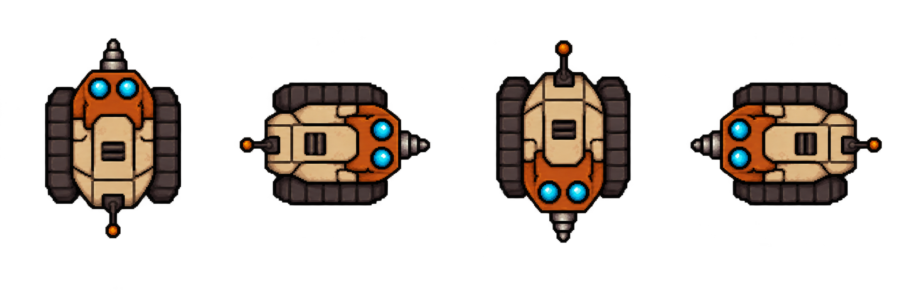
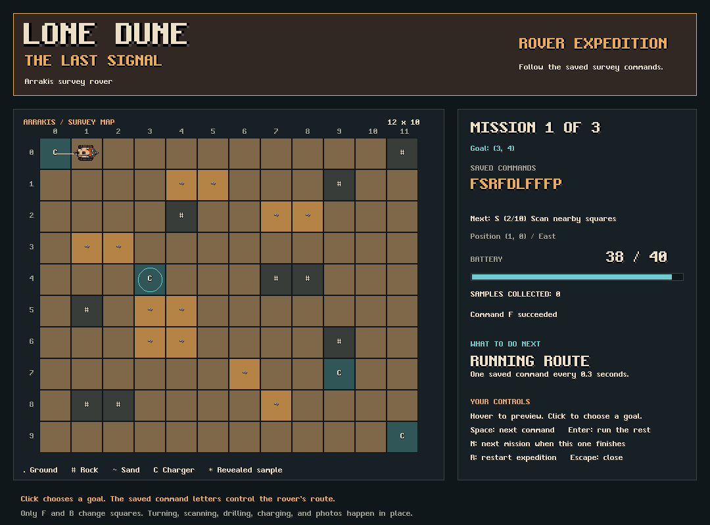

<p align="center">
  
</p>

# Lone Dune: The Last Signal

**Dane Anderson · CSCI 1300**

Welcome to Arrakis. One rover, three missions, and a battery to keep an eye on.

This is my Dune-themed version of the Rover Expedition project. The rover follows saved command lists across a desert map, scanning for samples, taking photos, and stopping to recharge. Its position, battery, and collected samples carry into the next mission.

**[Download the game files](https://github.com/dane-anderson/lone-dune/archive/refs/heads/main.zip) · [Full guide](START_HERE.md)**



## Give it a try

Click a clear square to choose a goal. **Space** runs one command; **Enter** runs the rest. When a mission ends, **N** starts the next one. **R** restarts the expedition, and **Escape** closes the game.

The click sets the goal. The letters in [missions.txt](rover/missions.txt) decide where the rover actually goes.

## Run it on a Mac

Download or clone this repository. With Apple's command-line developer tools installed, open a terminal **inside the downloaded project folder** and run:

```sh
bash tools/build.sh
```

You can also double-click **Run Lone Dune.command in Finder**. The script builds the current code before opening the game.

## Take a look around

- [Start at main.cpp](rover/main.cpp) to follow the program from loading files to handling controls.
- [See the rover rules](rover/Rover.cpp) for movement, battery costs, scanning, and drilling.
- [See how the screen is drawn](rover/WorldView.cpp), including the rover sprite and sliding movement.
- [Read the full guide](START_HERE.md) for the file map, commands, and saved results.

The [rule checks](tests/tests.cpp) run without opening the game:

```sh
bash tools/check.sh
```

---

Based on the course's rover starter and supplied Graphics1300 library. AI assistance was used for code and rover artwork.
